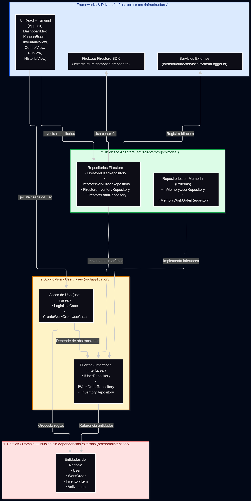

# CORMA — Sistema MES (Manufacturing Execution System)

Sistema web de ejecución de manufactura diseñado para Mecanizados Metálicos Industriales CORMA S.A. de C.V., que digitaliza el control de producción, el inventario de herramientas y estado de maquinaria, el control operativo y la gestión de recursos humanos.

## Equipo

| Nombre | Expediente | Rol |
| Leonardo Cortés Martínez | 333312 | Arquitectura, Frontend & Integración Firebase |


## Stack Tecnológico

* Lenguaje: TypeScript
* Frontend/UI: React + Vite + Tailwind CSS
* Base de Datos / Backend: Firebase Cloud Firestore
* Arquitectura: Clean Architecture

## Arquitectura



El sistema implementa Clean Architecture respetando la Regla de Dependencia, todas las dependencias apuntan hacia el núcleo del dominio; el dominio no importa React ni Firebase

* src/domain/entities/ (Entities / Domain): Entidades puras del negocio (User, WorkOrder, InventoryItem, ActiveLoan) sin dependencias de frameworks externos.
* src/application/ (Use Cases & Ports): Casos de uso (LoginUseCase, CreateWorkOrderUseCase) y contratos de persistencia (interfaces/IUserRepository, IWorkOrderRepository, IInventoryRepository).
* src/adapters/repositories/ Interface Adapters: Implementaciones concretas de los puertos para Firebase Firestore (FirestoreUserRepository, FirestoreWorkOrderRepository, FirestoreInventoryRepository, FirestoreLoanRepository) y repositorios en memoria para pruebas (InMemoryUserRepository, InMemoryWorkOrderRepository).
* src/infrastructure/ (Frameworks & Drivers): Configuración de Firebase (database/firebase.ts), bitácora del sistema (services/systemLogger.ts) e interfaz de usuario en React (ui/pages/Dashboard.tsx, ui/views/KanbanBoard.tsx, InventarioView.tsx, ControlView.tsx, RHView.tsx, HistorialView.tsx).

## Cómo correrlo localmente

1. Requisitos:
   * Node.js `v18+` y `npm` `v9+`
   * Cuenta / proyecto activo en Firebase Firestore

2. **Configurar variables de entorno:**
   ```bash
   cp .env.example .env